<picture>
  <source media="(prefers-color-scheme: dark)" srcset="https://raw.githubusercontent.com/axs-official/axs-official/main/assets/hero-dark.svg">
  <source media="(prefers-color-scheme: light)" srcset="https://raw.githubusercontent.com/axs-official/axs-official/main/assets/hero-light.svg">
  
</picture>

 

Self-taught developer in Algeria. I build small tools that save time: scripts, little apps, and sites.

[Website](https://axs-official.github.io) &nbsp;·&nbsp; [About](https://axs-official.github.io/about) &nbsp;·&nbsp; [Work](https://axs-official.github.io/work) &nbsp;·&nbsp; [Stack](https://axs-official.github.io/stack) &nbsp;·&nbsp; [Email](mailto:axs.official@gmail.com)

 

<picture>
  
</picture>

## About

I started with Python because I was tired of doing the same clicks every day. That turned into
scripts, then small apps, then the automation side of things I like most.

Most of my repos are private while they're rough. What's finished goes public, and the rest of it
lives on my [site](https://axs-official.github.io). If you want to see how I work, ask and I'll send
you the code.

## What I use

<picture>
  
</picture>

## This year on GitHub

<picture>
  
</picture>

Open to work and to anything with a boring manual step in it.
[axs.official@gmail.com](mailto:axs.official@gmail.com)

  Algeria · UTC+1 · <a href="https://github.com/axs-official">github.com/axs-official</a>

